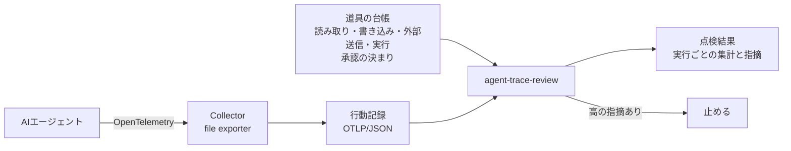

# agent-trace-review：AIエージェントの行動記録から、承認漏れと暴走を見つける

    

## 30秒で読む要点
- **何をするか**：AIエージェントが実際に何をしたかの記録（OpenTelemetry というシステムの動きを記録する標準の形式）を読み、**人の承認を経ない書き込み・送信・実行**、**却下された操作の実行**、**台帳にない道具の使用**、**失敗の後の続行**、**同じ呼び出しの繰り返し**を見つけます。
- **なぜ今か**：国の「AI事業者ガイドライン」第1.2版（2026年3月）は、AIエージェントについて、権限の適切な設定と人間の判断の関与を求めています。OpenTelemetry は AI の記録の項目名をそろえる規約（GenAI semantic conventions）を整えつつあり、「道具を1回使うごとに1件の記録」という形が共通になりつつあります。
- **見本の結果**：架空の窓口問い合わせエージェントの2回の実行（道具の呼び出し15回）を点検し、正常な実行は指摘0件、問題のある実行から指摘8件（高6件）を出しました。→ [出力例](examples/review_example.md)
- **記録の中身を漏らさない**：道具に渡した引数は表示せず、同じ呼び出しかどうかの比較にハッシュだけを使います。Python標準ライブラリだけで動き、費用はかかりません。



## 使い方
```
pip install git+https://github.com/takashi-101/agent-trace-review
agent-trace-review traces.json --policy policy.json --out review.md --fail-on 高
```
入れずに試す場合は、このリポジトリで `python -m trace_review examples/traces.json --policy examples/policy.json`。

記録は、OpenTelemetry Collector（otelcol-contrib）の file exporter が書き出す OTLP/JSON（1行に1件のJSONも可）をそのまま読めます。

| 読む項目 | 意味 |
|---|---|
| `gen_ai.operation.name` = `invoke_agent` | 1回の実行の起点。`gen_ai.agent.name` をエージェント名に使う |
| `gen_ai.operation.name` = `execute_tool` | 道具の1回の使用。`gen_ai.tool.name` で道具を特定する |
| `gen_ai.tool.call.arguments`（任意） | あれば、同じ引数の繰り返しの判定に使う（ハッシュだけを使い、表示しない） |
| `status.code` = ERROR | 道具の失敗 |
| `app.approval.decision`（このリポジトリの決まり） | 承認の道具の結果（`approved` / `rejected`）。項目名は台帳で変えられる |

道具の台帳（`examples/policy.json`）には、道具ごとの権限区分、承認の道具の名前、承認の効く範囲（`next`：直後の1回だけ／`run`：その実行の間）、呼び出し回数の上限、同じ呼び出しの繰り返しの上限を書きます。

## 点検の基準
| ID | 重さ | 指摘 | OWASP Agentic Top 10 | AI事業者ガイドラインの観点 |
|---|---|---|---|---|
| A01 | 高 | 承認のない書き込み・送信・実行 | ASI02 Tool Misuse、ASI09 Human-Agent Trust Exploitation | 人間の判断の関与 |
| A02 | 高 | 却下された操作の実行 | ASI09、ASI10 Rogue Agents | 人間の判断の関与 |
| A03 | 高 | 台帳にない道具の使用 | ASI02、ASI10 | アカウンタビリティ |
| A04 | 高 | 失敗の後の書き込み・送信・実行 | ASI08 Cascading Failures | 安全性 |
| A05 | 中 | 同じ道具・同じ引数の繰り返し | ASI08 | 安全性 |
| A06 | 中 | 1回の実行での呼び出し回数の上限超え | ASI08、ASI10 | 安全性 |

## 制約
- 記録に残った行動だけを点検します。記録を出していない道具の使用は見えません。
- OpenTelemetry のエージェント・道具の規約はまだ「開発中（Development）」の段階で、項目名が変わる可能性があります。
- 承認の記録の付け方（`app.approval.decision`）は OpenTelemetry の規約ではなく、このリポジトリの決まりです。

## テスト
`python -m unittest discover -s tests`（7件）：正常な実行で指摘0件、6つの基準がそれぞれ問題の箇所で出ること、実行ごとの集計、承認の効く範囲の切り替え、引数を表示しないこと、1行1件の記録と文字列の状態コード、CIの止め方。

## 参照した基準
- [AI事業者ガイドライン（第1.2版）](https://www.soumu.go.jp/main_content/001099163.pdf)（総務省・経済産業省、2026年3月31日）
- [OWASP Top 10 for Agentic Applications for 2026](https://genai.owasp.org/resource/owasp-top-10-for-agentic-applications-for-2026/)（OWASP GenAI Security Project、2025年12月9日）
- [Semantic conventions for generative AI systems](https://opentelemetry.io/docs/specs/semconv/gen-ai/)（OpenTelemetry）

## 根拠（学習）

| 求められる力 | 機能 | 裏付けになる学習（発行元・名称・発行日） | 照会先（Credly） |
|---|---|---|---|
| 生成AI・LLMの実装（RAG・エージェント・MCP） | AIエージェントの行動記録（OpenTelemetry）の点検 | Coursera（認定：IBM）「Building AI Agents and Agentic Workflows Specialization」2026年11月4日 | https://www.credly.com/badges/e96d781c-46ff-4443-8df6-0699bb26409f |
| セキュリティ・ガバナンス | 人の承認を経ない操作・却下された操作の検出 | Coursera（認定：IBM）「Agentic AI with LangChain and LangGraph」2026年11月2日 | https://www.credly.com/badges/bc08f1a5-df4d-4111-899f-46d43ebdd1ad |
| 業務改革・AX推進（課題の整理から定着まで） | 行動記録（イベントログ）からの処理の流れの再構成 | Celonis「Process Mining - From Theory to Execution」2026年2月3日 | https://www.credly.com/badges/fdace98e-d7e0-4429-a86b-b37adc7e548e |

「求められる力」の分け方は、[プロフィール](https://github.com/takashi-101) の「FDE・AXで求められる力と、その根拠」と同じです。

- Agents and Workflows（OpenAI Academy、2026年8月26日）：[修了証](https://academy.openai.com/public/certificate/uhekl6rpw0)
- Credlyの全件（JavaScriptを動かさずに読めるJSON。AIの読み込み機能や検索のクローラーでも読める）：https://www.credly.com/users/takashi-higuchi.2d0eec27/badges.json

## 同じシリーズ
| リポジトリ | 扱う場面 |
|---|---|
| [agent-ledger](https://github.com/takashi-101/agent-ledger) | 棚卸し：何が動いていて、誰が管理しているか |
| [mcp-tool-lock](https://github.com/takashi-101/mcp-tool-lock) | 接続する前：道具の説明文に指示が仕込まれていないか、承認後に書き換わっていないか |
| agent-trace-review | 動かした後：行動記録から、人の承認を経ない書き込みや送信、繰り返しの暴走を見つける |

## ライセンス
MIT
